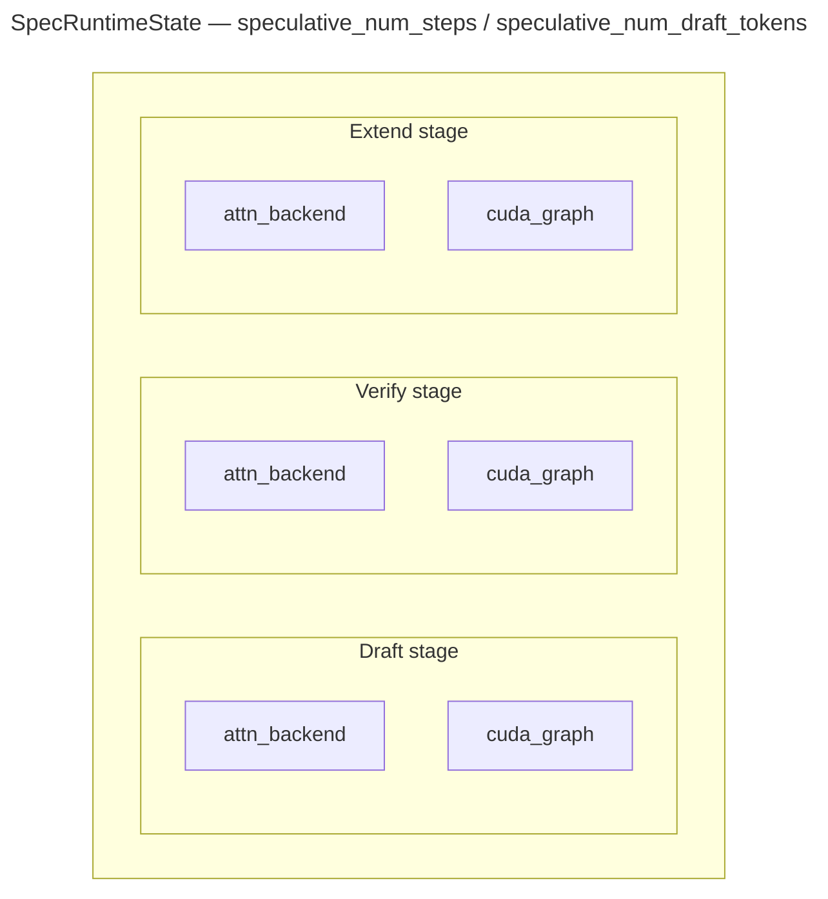
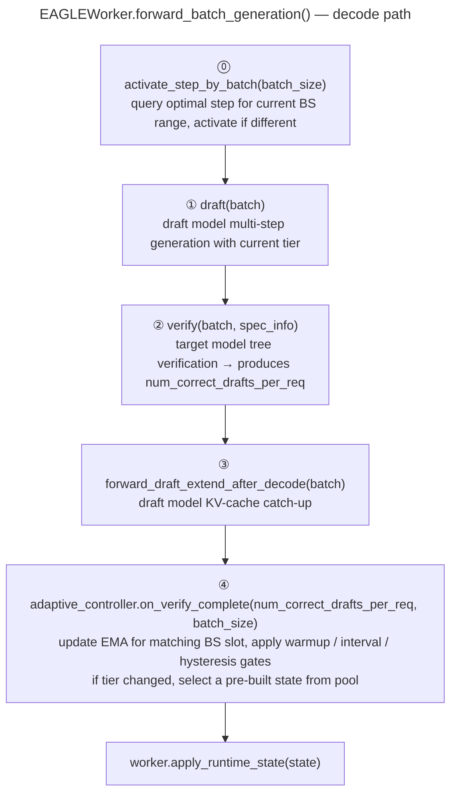

自适应投机解码让 SGLang 在运行时调整 `speculative_num_steps`/`speculative_num_draft_tokens`，而不是在整个服务生命周期内保持一个固定值。它面向接受长度随时间变化的工作负载——这类场景下，单一的静态步数很少是最优的。

<Note>
💡 AI Infra 学习笔记：投机解码的收益取决于「草稿步数」与「接受率」是否匹配。步数太少，草稿模型的潜力没挖完；步数太多，被拒绝的候选 token 白白消耗算力——而且在大批大小下，每一轮浪费都要乘上批内请求数，代价被放大。固定一个 `num_steps` 很难同时适配低并发和高并发，这正是自适应投机解码存在的意义。
</Note>

## 当前支持

- 仅支持 `--speculative-algorithm EAGLE` 或 `EAGLE3`
- 仅支持 `--speculative-eagle-topk 1`
- 若不满足任一条件，SGLang 会回退到静态投机设置

## 为什么自适应的步数有帮助

`speculative_num_steps` 控制每一轮投机中草稿模型运行多少步自回归。实践中，最优值取决于当前工作负载。

- 如果 `num_steps` 太小，草稿模型本可以产生更多被接受的 token，但这一轮提前结束了。
- 如果 `num_steps` 太大，草稿模型产生大量被目标模型拒绝的候选 token，额外的草稿工作就白费了。
- 在**大批大小**下，每个被浪费的草稿步的成本会乘上批内所有序列的数量，因此最优步数往往比小批大小更低。

真实流量常常在高接受率与低接受率阶段之间切换，批大小也持续变化。自适应模式在运行时同时跟随这两种信号，而不是硬编码一个全局的 `num_steps`。

## 设计概览

自适应机制由三部分组成：

- `AdaptiveSpeculativeParams`：基于 EMA 的策略
- `SpecRuntimeState`：每个档位（tier）的运行时状态包
- `AdaptiveController`：协调器，查询当前批大小对应的策略并激活匹配的运行时状态

### 按批大小独立跟踪

控制器为**每个批大小区间维护独立的 EMA 跟踪器**，这样小批大小的观测不会污染大批大小的信号。每个 BS 区间都可以有自己的候选步数、迟滞阈值和上限系数。

BS 区间在配置文件中以区间下界定义（例如，键 `"1"` 和 `"8"` 表示 BS 1–7 使用一个槽位，BS 8+ 使用另一个）。步数相同的 BS 区间会共享 `SpecRuntimeState` 对象——每个状态持有该步数可达的补齐批大小所捕获的 CUDA 图。



这一点很重要，因为 `CudaGraphRunner` 对形状敏感。每个候选档位拥有自己的图和后端状态，因此运行时切换只是引用交换，而不是在线重新捕获图。

## 运行时流程

自适应更新发生在两处：

1. **草稿前**：查询当前批大小的最优步数，若不同则激活
2. **验证后**：用观测到的接受长度更新对应 BS 槽位的 EMA



> 档位切换发生在当前轮结束后。后端和 CUDA 图绝不在轮次中途切换。

## 策略如何决策

每次验证通过后，SGLang 读取每个请求的接受草稿长度，计算批平均值，用指数移动平均（EMA）平滑，并在对应 BS 槽位的候选档位之间切换。

<Note>
💡 AI Infra 学习笔记：EMA + 迟滞（hysteresis）是自适应系统的经典工程组合：EMA 用指数加权平均平滑噪声，迟滞阈值（上调/下调各留余量）避免系统在档位边界反复横跳，预热与更新间隔则限制切换频率。理解这套机制对设计任何在线自适应、动态调整批大小或步数的系统都有借鉴意义。
</Note>

决策逻辑刻意保持保守：

- `warmup_batches` 跳过最初的几批
- `update_interval` 避免每批都切换
- `down_hysteresis` 和 `up_hysteresis` 减少振荡
- `ceiling_coeff`——可选的 EMA 上限规则，能按观测到的草稿质量成比例地封顶 `num_steps`，防止大批大小下过度投机

概念上，策略会在观测到的接受长度基础上多试探一步：

```text
target_steps ≈ clamp(round(ema_accept_len) + 1, min(candidate_steps), max(candidate_steps))
```

所以，如果最近的请求持续接受更多草稿 token，策略倾向于上调；如果更早开始拒绝，则倾向于下调。

## 使用方法

`--speculative-adaptive-config` 是可选的，但投机配置本身仍须对自适应模式有效。

```bash
python3 -m sglang.launch_server \
    --model meta-llama/Llama-2-7b-chat-hf \
    --speculative-algorithm EAGLE \
    --speculative-draft-model-path lmsys/sglang-EAGLE-llama2-chat-7B \
    --speculative-eagle-topk 1 \
    --speculative-num-steps 3 \
    --speculative-num-draft-tokens 4 \
    --speculative-adaptive
```

如果想覆盖默认值，加上 `--speculative-adaptive-config /path/to/adaptive_spec.json`。

示例配置：

```json
{
  "ema_alpha": 0.2,
  "warmup_batches": 10,
  "update_interval": 5,
  "1": {"candidate_steps": [1, 3, 7], "up_hysteresis": 0.0, "down_hysteresis": -0.25, "ceiling_coeff": 0},
  "8": {"candidate_steps": [1],       "up_hysteresis": 0.0, "down_hysteresis": 0.0,   "ceiling_coeff": 0}
}
```

非整数键（`ema_alpha`、`warmup_batches`、`update_interval`）是作用于每个 BS 槽位的全局覆盖。整数键（`"1"`、`"8"`）定义按 BS 区分的槽位。

## 配置文件参考

配置文件是可选的。提供时，每个整数 BS 槽位键必须指定 `candidate_steps`；其余键回退到默认值。

### 按 BS 槽位的参数

<table style={{width: "100%", borderCollapse: "collapse", tableLayout: "fixed"}}>
  <colgroup>
    <col style={{width: "33.33%"}} />
    <col style={{width: "33.33%"}} />
    <col style={{width: "33.33%"}} />
  </colgroup>
  <thead>
    <tr>
      <th>键</th>
      <th>默认值</th>
      <th>含义</th>
    </tr>
  </thead>
  <tbody>
    <tr>
      <td><code>candidate_steps</code></td>
      <td><em>必填</em></td>
      <td>该 BS 区间的候选 <code>speculative_num_steps</code> 档位。必须是正整数构成的非空列表；省略它的槽位会触发配置错误</td>
    </tr>
    <tr>
      <td><code>down_hysteresis</code></td>
      <td><code>-0.25</code></td>
      <td>下调到更小步数前的额外余量</td>
    </tr>
    <tr>
      <td><code>up_hysteresis</code></td>
      <td><code>0.0</code></td>
      <td>上调到更大步数前的额外余量</td>
    </tr>
    <tr>
      <td><code>ceiling_coeff</code></td>
      <td><code>0</code>（禁用）</td>
      <td>EMA 上限系数；设为 &gt; 0 可按草稿质量成比例地封顶步数</td>
    </tr>
  </tbody>
</table>

### 全局参数

<table style={{width: "100%", borderCollapse: "collapse", tableLayout: "fixed"}}>
  <colgroup>
    <col style={{width: "33.33%"}} />
    <col style={{width: "33.33%"}} />
    <col style={{width: "33.33%"}} />
  </colgroup>
  <thead>
    <tr>
      <th>键</th>
      <th>默认值</th>
      <th>含义</th>
    </tr>
  </thead>
  <tbody>
    <tr>
      <td><code>ema_alpha</code></td>
      <td><code>0.2</code></td>
      <td>接受草稿长度的 EMA 平滑因子</td>
    </tr>
    <tr>
      <td><code>update_interval</code></td>
      <td><code>5</code></td>
      <td>预热后，以验证批为单位的重新计算间隔</td>
    </tr>
    <tr>
      <td><code>warmup_batches</code></td>
      <td><code>10</code></td>
      <td>切换前需要观测的验证批数量</td>
    </tr>
  </tbody>
</table>

## 监控

你可以通过 `/server_info` 查看当前激活的档位和接受率指标：

```bash
curl -s http://127.0.0.1:30000/server_info | jq '.internal_states[0] | {speculative_num_steps, avg_spec_accept_length}'
```

- `speculative_num_steps` 是当前激活的档位
- `avg_spec_accept_length` 有助于判断服务端可能会上调还是下调

## 调优建议

- 从内置默认（保守）配置开始——它对所有草稿模型质量都安全
- 对强草稿模型，使用带上限规则的激进配置
- 想降低启动时的 GPU 显存开销，就减少候选步数
- 增大 `ema_alpha` 以更快响应，降低它则更稳定
- 如果档位切换过于频繁，增大 `warmup_batches` 或 `update_interval`
- 在大批大小下，较窄的阶梯（如 `[1, 2]` 或 `[1]`）通常优于宽阶梯
- 如果你的工作负载已经稳定、且某个静态配置调得很好，自适应模式可能帮助不大

## 推荐配置

内置默认是保守的——对所有草稿模型都安全，但对强草稿模型可能投机不足。把下面某个配置保存为 JSON 文件，并通过 `--speculative-adaptive-config` 传入。

### 保守（默认）——面向弱草稿模型

这就是内置默认：BS 8–31 允许 `[1, 3]`，BS≥32 锁定 `step=1` 以避免浪费算力。最适合 MiniMax-M2.5、DSV4 这类模型。

```json
{
  "1":  {"candidate_steps": [1, 3, 7], "up_hysteresis": 0.0, "down_hysteresis": -0.25, "ceiling_coeff": 0},
  "8":  {"candidate_steps": [1, 3],    "up_hysteresis": 0.0, "down_hysteresis": 0.0,   "ceiling_coeff": 0},
  "32": {"candidate_steps": [1],       "up_hysteresis": 0.0, "down_hysteresis": 0.0,   "ceiling_coeff": 0}
}
```

### 激进——面向强或高方差草稿模型

使用更宽的阶梯配合上限规则，在大批大小下封顶投机。最适合 GLM-4.7-FP8 这类模型。

```json
{
  "1":   {"candidate_steps": [1, 3, 7], "up_hysteresis": 0.0, "down_hysteresis": -0.25, "ceiling_coeff": 0},
  "8":   {"candidate_steps": [1, 3, 7], "up_hysteresis": 0.0, "down_hysteresis": -0.25, "ceiling_coeff": 3.0},
  "64":  {"candidate_steps": [1, 3],    "up_hysteresis": 0.0, "down_hysteresis": -0.25, "ceiling_coeff": 1.67},
  "128": {"candidate_steps": [1, 3],    "up_hysteresis": 0.0, "down_hysteresis": -0.25, "ceiling_coeff": 1.2}
}
```

### 自定义按模型配置

为了最佳性能，请在多个批大小下用不同的静态 `num_steps` 对你的模型做基准测试，然后构建一个让每个区间匹配其最优步数的按 BS 配置。调好的按模型配置可能优于上面的通用预设。
